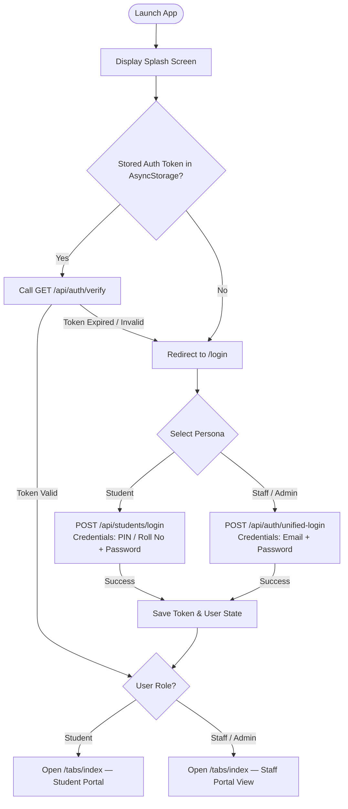
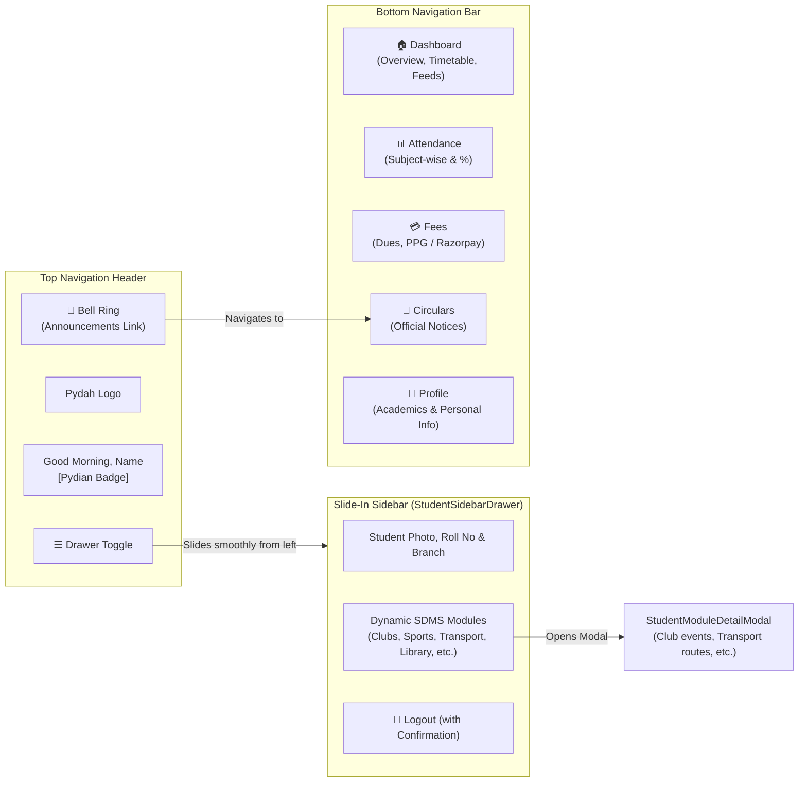
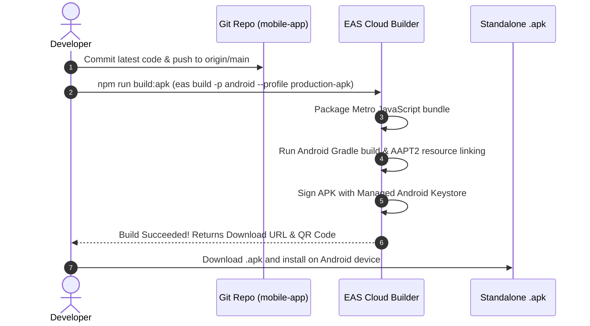

# Pydah Student Portal — Mobile Application (SDMS Mobile)

The official cross-platform React Native mobile application for the **Pydah Student Data Management System (SDMS)**. Built with **Expo (SDK 54)**, **React Native 0.81**, **React 19**, **Expo Router**, and **TypeScript**.

The application provides a centralized, role-aware portal for **Students** and **Staff**, integrating student attendance tracking, fee management with PPG/Razorpay checkout, institutional announcements, and dynamic campus modules configured via SDMS Portal Layout settings.

---

## 📑 Table of Contents
1. [Tech Stack](#-tech-stack)
2. [Application Flow & Architecture](#-application-flow--architecture)
3. [User Guide — How to Use the App](#-user-guide--how-to-use-the-app)
4. [APK Generation & Build Flow](#-apk-generation--build-flow)
5. [Installing & Testing the APK on Android](#-installing--testing-the-apk-on-android)
6. [Critical Build Best Practices & Troubleshooting](#-critical-build-best-practices--troubleshooting)
7. [Local Development Setup](#-local-development-setup)
8. [Directory Structure](#-directory-structure)

---

## 🛠 Tech Stack

| Component | Technology | Version / Spec |
|---|---|---|
| **Framework** | Expo | `~54.0.35` |
| **Mobile Runtime** | React Native | `0.81.5` |
| **UI Library** | React | `19.1.0` |
| **Navigation** | Expo Router (File-based) | `~6.0.24` |
| **Language** | TypeScript | `~5.9.2` |
| **Icons** | Lucide React Native | `^0.562.0` |
| **Animations** | React Native Reanimated & Animated API | `~4.1.1` |
| **Build System** | Expo Application Services (EAS Build) | `eas-cli >= 12.0.0` |

---

## 🔄 Application Flow & Architecture

### 1. Authentication & Routing Flow



---

### 2. Student Navigation Flow



---

## 📖 User Guide — How to Use the App

### For Students

#### 1. Signing In
- Open the application.
- On the **Student** tab, enter your **Student PIN / Roll Number** and **Password**.
- Toggle **Remember Me** to stay signed in between sessions.
- Tap **Sign In**. If you forgot your credentials, tap **Forgot Password?** to initiate password recovery.

#### 2. Student Dashboard (`app/(tabs)/index.tsx`)
- **Header**: Shows your name with the orange **Pydian** badge and your institution logo.
- **Top Quick Stats**: View real-time attendance percentage and outstanding fee dues summary cards.
- **Timetable / Today's Schedule**: Review ongoing and upcoming lecture periods.
- **Dynamic Campus Modules**: Tiles for Clubs, Library, Examinations, and Transport configured dynamically from the SDMS server.
- **Interactive Modals**: Tapping on any campus module opens the **StudentModuleDetailModal** with full details and event actions.

#### 3. Sliding Sidebar Navigation (`src/components/StudentSidebarDrawer.tsx`)
- Tap the **☰ (Menu)** icon at the top left of the header.
- A smooth animated drawer slides in from the left displaying:
  - Student avatar, full name, registration number, branch, and academic year.
  - Quick shortcuts to SDMS modules.
  - A secure **Logout** button with confirmation prompt.
- Tap anywhere outside the drawer or the close icon to smoothly dismiss the sidebar.

#### 4. Attendance Tracker (`app/(tabs)/attendance.tsx`)
- View your **Overall Attendance Percentage** with a color-coded circular progress gauge.
- **Attendance Threshold**: Highlights whether you are above or below the mandatory 75% threshold.
- **Subject Breakdown**: Drill down into individual subjects to view Total Classes Conducted, Classes Attended, and percentage.

#### 5. Fees & Online Payments (`app/(tabs)/fees.tsx`)
- **Dues Summary**: Review pending tuition, hostel, transport, or examination fees broken down by academic term.
- **Make Payment**: Tap **Pay Now** to launch the integrated **Pydah Payment Gateway (PPG)** or Razorpay checkout.
- **Payment History**: View previous transaction receipts, status (Success/Pending), and reference IDs.

#### 6. Circulars & Notices (`app/(tabs)/announcements.tsx`)
- Access directly from the bottom navigation or by tapping the **🔔 Bell** icon in the header.
- Filter through college circulars, department memos, and emergency notices.
- Tap an item to view the full circular text and attached banner images.

#### 7. Profile (`app/(tabs)/profile.tsx`)
- Review verified student bio, parent contact info, residential details, and enrolled course curriculum.

---

### For Staff & Admins

- On the login screen, select the **Staff** tab.
- Enter your registered college staff email and password.
- The app automatically loads the **StaffDashboard**:
  - **Class Attendance Marking**: Mark period attendance for assigned batches.
  - **Fee Status Overview**: Look up student fee clearance status.
  - **Circular Management**: Post or broadcast official notices.

---

## 📦 APK Generation & Build Flow

The mobile app uses **EAS Build (Expo Application Services)** to compile standalone Android installable `.apk` packages.

### 1. Build Profiles in `eas.json`

| Profile Name | Output Format | Target Backend API | Use Case |
|---|---|---|---|
| `production-apk` | **Standalone APK** (`.apk`) | Production (`https://sdms.pydah.edu.in/api`) | **Distribution to students & staff for direct installation** |
| `preview` | Standalone APK (`.apk`) | Production (`https://sdms.pydah.edu.in/api`) | Internal testing & QA |
| `development` | Dev Client APK (`.apk`) | Local/LAN (`http://192.168.x.x:5000/api`) | Local debugging with live reloading |
| `production` | Android App Bundle (`.aab`) | Production (`https://sdms.pydah.edu.in/api`) | Google Play Store publication |

---

### 2. Prerequisites for Building the APK

1. **Install EAS CLI globally**:
   ```bash
   npm install -g eas-cli
   ```
2. **Log in to your Expo account**:
   ```bash
   eas login
   ```
   *(Verify your account has access to project `dfd664bd-0f17-41a3-a4d3-05e1ecb72fcb`)*.
3. **Ensure working tree is clean and committed**:
   ```bash
   cd mobile-app
   git status
   ```

---

### 3. Step-by-Step: Cloud APK Build (Recommended)

This is the standard flow that compiles the release APK on Expo's cloud build servers:



#### Command:
```bash
cd mobile-app
npm run build:apk
```
*Equivalent to:*
```bash
eas build -p android --profile production-apk
```

- When the build starts, EAS provides a **live build log URL** in your terminal.
- Once finished (typically 5–10 minutes), EAS prints a direct download link and terminal QR code for the `.apk` file.

---

### 4. Step-by-Step: Local APK Build (Alternative)

If you have Android Studio, Java 17+, and the Android SDK configured locally on your computer, you can build without using cloud build credits:

```bash
cd mobile-app
npm run build:apk:local
```

The compiled APK will be generated locally in the working directory upon completion.

---

## 📲 Installing & Testing the APK on Android

1. **Download the APK**:
   - Open the EAS download URL in your Android device's browser (Chrome), or scan the terminal QR code.
2. **Enable Unknown Apps Installation**:
   - If prompted: *“For your security, your phone is not allowed to install unknown apps from this source”*:
     1. Tap **Settings** on the prompt.
     2. Toggle **Allow from this source** to **ON**.
     3. Press back to return to the installer.
3. **Install the App**:
   - Tap **Install** and wait for the installation progress bar to complete.
   - If Google Play Protect shows a dialog, tap **Install Anyway**.
4. **Launch & Verify**:
   - Open **Pydah Student Portal**.
   - Check that the header displays the **Pydian** badge and the updated notification icon.
   - Tap the hamburger menu **☰** to verify the left drawer slide-in animation.

---

## ⚠️ Critical Build Best Practices & Troubleshooting

### 1. Why Changes May Not Reflect in a New APK

If you make code changes but the resulting APK does not show them:

1. **Check for Accidental Git Reverts**:
   - Never run `git revert HEAD` blindly when a build fails. Running `git revert` restores the code to the previous commit, silently undoing your recent changes before the build starts.
   - Run `git log -n 5 --oneline` to confirm your desired commits are at the top of the history.
2. **Verify Branch & Remote Synchronization**:
   - EAS Build reads the committed state. Always run:
     ```bash
     git status
     git commit -m "your changes"
     git push origin main
     ```
   - If EAS prompts *"You have uncommitted changes"*, either commit them or confirm pushing local changes.
3. **Verify App Version / Build Hash**:
   - Check the commit hash listed in the EAS build dashboard to confirm it matches your latest local commit.

---

### 2. AAPT2 Compilation / Asset Resource Errors

Android's AAPT2 compiler is strict with asset files in `assets/`:
- **No spaces in filenames**: Avoid filenames like `boy animated.png`. Use kebab-case: `boy-animated.png`.
- **Valid PNG headers**: Ensure images with `.png` extensions are real PNG files and not renamed JPEGs or WebPs.

---

### 3. Dependency Matching (Expo SDK 54)

- **Do NOT install packages meant for newer SDK versions**:
  - This project runs **Expo SDK 54** (`"expo": "~54.0.35"`).
  - Installing packages built for higher versions (e.g. `expo-widgets ^58.0.0`) will break native Gradle compilation.
  - Always install compatible libraries using:
    ```bash
    npx expo install <package-name>
    ```
    This automatically selects the version validated for Expo SDK 54.

---

### 4. API Connectivity Issues on Android Devices

- **Production APK**: Automatically connects to HTTPS production endpoints (`https://sdms.pydah.edu.in/api`). Ensure the production server has a valid SSL certificate.
- **Development Builds on Local Wi-Fi**:
  - Android blocks non-HTTPS (cleartext HTTP) traffic by default unless configured.
  - Ensure your phone and development computer are connected to the **same Wi-Fi network**.
  - In `src/config/env.ts`, smart host detection auto-maps `localhost` to your machine's LAN IP (`192.168.x.x`).

---

## 💻 Local Development Setup

### 1. Install Dependencies
```bash
cd mobile-app
npm install
```

### 2. Verify TypeScript Compilation
Always ensure there are no typing errors before starting or building:
```bash
npx tsc --noEmit
```

### 3. Start Expo Dev Server
```bash
npx expo start
```
- Press `a` to open in a connected **Android Emulator**.
- Press `w` to open in a **Web Browser**.
- Scan the displayed QR code with the **Expo Go** app on your physical Android device.

---

## 📁 Directory Structure

```text
mobile-app/
├── app/                              # Expo Router (File-based navigation)
│   ├── _layout.tsx                   # Root provider layout (Auth, SafeArea)
│   ├── (auth)/                       # Authentication screens
│   │   ├── _layout.tsx
│   │   ├── login.tsx                 # Student & Staff login toggle
│   │   └── forgot-password.tsx       # Password recovery flow
│   ├── (tabs)/                       # Authenticated tab navigation
│   │   ├── _layout.tsx               # Bottom tab bar configuration
│   │   ├── index.tsx                 # Student / Staff Dashboard
│   │   ├── attendance.tsx            # Attendance summary & subject breakdown
│   │   ├── fees.tsx                  # Fee dues, ledger, and PPG payment
│   │   ├── announcements.tsx         # Circulars, campus notices & banners
│   │   └── profile.tsx               # Student details & account settings
│   ├── operation/[key].tsx           # SDMS operation view
│   └── student-module/[id].tsx       # Deep-link view for individual modules
├── assets/                           # Branding, icons, splash images
├── src/
│   ├── components/                   # Reusable UI components
│   │   ├── Header.tsx                # Top header bar (logo, pydian badge, bell)
│   │   ├── StudentSidebarDrawer.tsx  # Animated sliding drawer navigation
│   │   ├── StudentModuleDetailModal.tsx # Dynamic module detail view
│   │   ├── StaffDashboard.tsx        # Staff home screen
│   │   ├── StaffAttendanceView.tsx   # Staff attendance marking view
│   │   ├── StaffFeesView.tsx         # Staff fee overview
│   │   ├── CustomButton.tsx          # Styled action button
│   │   ├── CustomInput.tsx           # Form input field
│   │   └── StatCard.tsx              # Metric summary card widget
│   ├── config/
│   │   ├── api.ts                    # Axios instance, Bearer token interceptor
│   │   └── env.ts                    # Multi-environment host resolution
│   ├── context/
│   │   └── AuthContext.tsx           # Session state, login/logout, persistence
│   ├── services/                     # Backend API services
│   │   ├── authService.ts            # Auth & password reset endpoints
│   │   ├── studentService.ts         # Profile, attendance & portal layout
│   │   ├── feeService.ts             # Fees & payment order creation
│   │   ├── staffService.ts           # Staff portal APIs
│   │   └── announcementService.ts    # Notices & circulars
│   ├── types/                        # TypeScript domain interfaces
│   └── utils/
│       ├── logger.ts                 # Structured app logger
│       └── rbac.ts                   # Role-based access control rules
├── app.json                          # Expo project manifest & native config
├── eas.json                          # EAS build profiles (production-apk, etc.)
├── package.json                      # NPM dependencies & build scripts
└── tsconfig.json                     # TypeScript path aliases (@/*)
```

---

## 📄 License & Maintainers

- **Project**: Pydah Student Data Management System (SDMS)
- **Organization**: Pydah Educational Academy
- **Repository**: [Pydah-Soft-Projects/SDMS-Mobile-App](https://github.com/Pydah-Soft-Projects/SDMS-Mobile-App)
